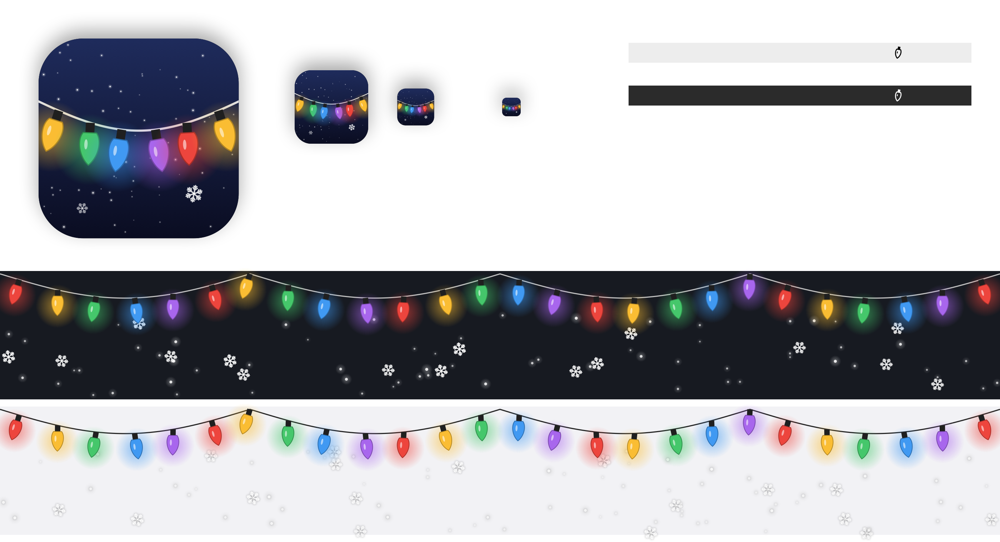

# FestiveLights

**DE:** Eine Lichterkette für die macOS-Menüleiste und das Dock, dazu sanft fallender Schnee, der auf Fenstern liegen bleibt. Kostenlos und Open Source (MIT), Mac App Store, macOS 14 oder neuer. Die App läuft in der Sandbox, sammelt keine Daten und braucht keine Berechtigungen.

**EN:** A string of lights for the macOS menu bar and the Dock, plus gently falling snow that settles on windows. Free and open source (MIT), Mac App Store, macOS 14 or newer. The app is sandboxed, collects no data and needs no permissions.


<!-- Screenshots folgen / screenshots to follow -->

## Bauen / Build

```sh
cp Local.xcconfig.example Local.xcconfig   # Team und Signatur eintragen / set your team and signing (nicht eingecheckt / not committed)
xcodegen generate
xcodebuild -project FestiveLights.xcodeproj -scheme FestiveLights -configuration Release build
xcodebuild test -scheme FestiveLights -destination 'platform=macOS'
```

Der Standard-Build ist die App-Store-Fassung (Sandbox, ohne Bedienungshilfen). Der Code für die genauere Dock-Erkennung über die Bedienungshilfen steht hinter dem Compile-Schalter `DIRECT` (`SWIFT_ACTIVE_COMPILATION_CONDITIONS = DIRECT`) und wird nicht ausgeliefert.
The default build is the App Store variant (sandboxed, no Accessibility). The code for more precise Dock tracking via Accessibility sits behind the `DIRECT` compile flag and is not shipped.

Entwicklungsbuilds mit Debug-Auslösern: Konfiguration `Test` (`-configuration Test`).

## Lizenz / License

MIT, siehe / see [LICENSE](LICENSE).

## Direkt-Download und Release / Direct download and release

**DE:** Neben der App-Store-Fassung gibt es eine Direkt-Variante (Target `FestiveLightsDirect`, Scheme `FestiveLights-Direct`, Compile-Schalter `DIRECT`): ohne Sandbox, mit optionaler Bedienungshilfen-Freigabe für die genauere Dock-Erkennung, Developer ID signiert und notarisiert, ausgeliefert als DMG. Updates laufen über [Sparkle](https://sparkle-project.org) (nur in dieser Variante gelinkt, einmal täglich, ohne Systemprofil, abschaltbar in Allgemein). Die App-Store-Fassung enthält weder Sparkle noch Update-Code.

```sh
export SPARKLE_BIN=/pfad/zu/sparkle/bin      # Ordner mit generate_appcast
scripts/release-direct.sh 1.0                # Archiv, Export (Developer ID), Notarisierung, DMG, appcast.xml unter release/1.0
```

**Ablauf eines Releases / release steps:** (1) `MARKETING_VERSION` und `CURRENT_PROJECT_VERSION` in `project.yml` erhöhen (Build-Nummer steigt mit jedem Upload) / bump the versions in `project.yml`; (2) `ReleaseNotes/<Version>.html` schreiben (HTML-Ausschnitt, oben Englisch, darunter Deutsch) / write the release notes; (3) `scripts/release-direct.sh <Version>`; (4) DMG, `FestiveLights.dmg` (feste Kopie), `appcast.xml` als GitHub-Release mit Tag gleich Version hochladen und als latest markieren / upload them as a GitHub release tagged with the version. Das Skript bricht ab, wenn die Release Notes fehlen, und übernimmt den bisherigen Verlauf aus dem letzten Release.

Das Skript braucht ein in Xcode angemeldetes Konto (oder `NOTARY_PROFILE` für `notarytool`, siehe Kopf des Skripts) und die Team-ID in `Local.xcconfig`. Der private Schlüssel für die Update-Signatur liegt nur im Schlüsselbund des Release-Rechners. DMG und `appcast.xml` werden als GitHub-Release hochgeladen.

**EN:** Besides the App Store build there is a direct variant (target `FestiveLightsDirect`, scheme `FestiveLights-Direct`, compile flag `DIRECT`): not sandboxed, optional Accessibility permission for more precise Dock tracking, Developer ID signed and notarized, shipped as a DMG. Updates use [Sparkle](https://sparkle-project.org) (linked in this variant only, once a day, no system profile, can be turned off in General). The App Store build contains neither Sparkle nor update code. `scripts/release-direct.sh <version>` archives, exports, notarizes, builds the DMG and the appcast; it needs a signed-in Xcode account (or a `notarytool` profile) and your team ID in `Local.xcconfig`.
