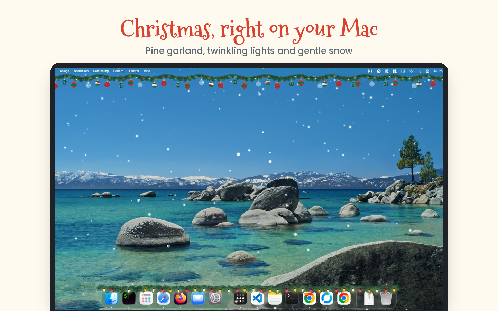
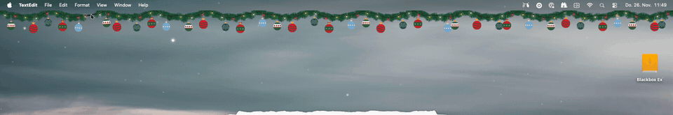
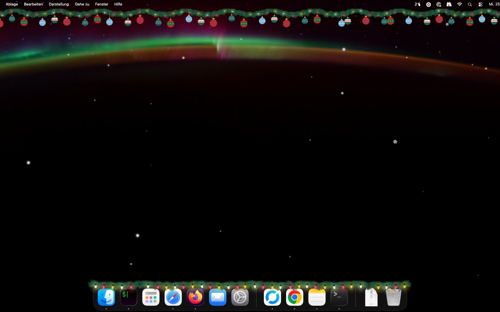
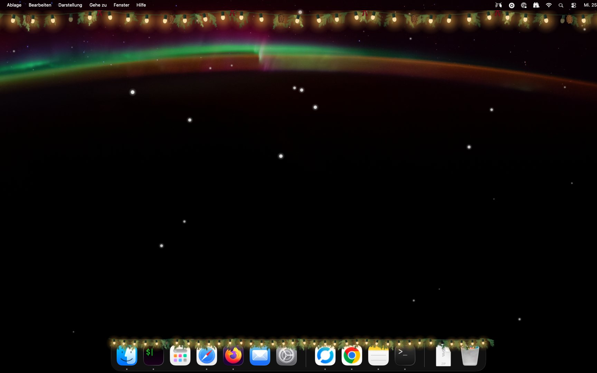
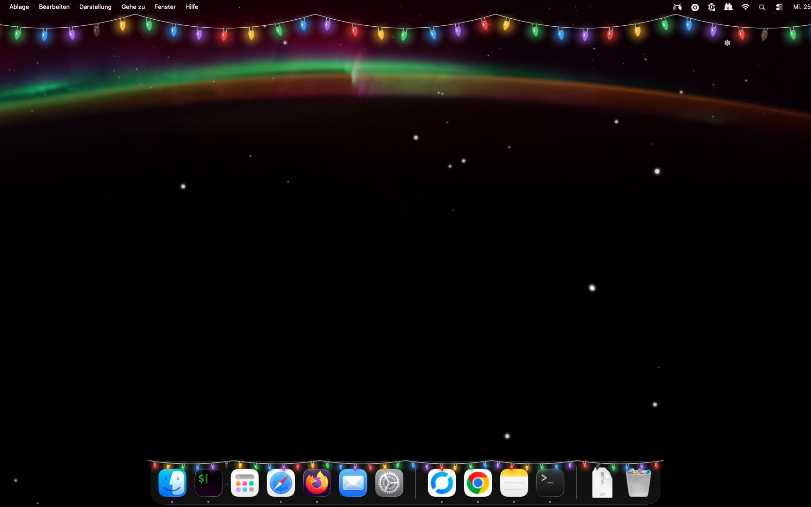
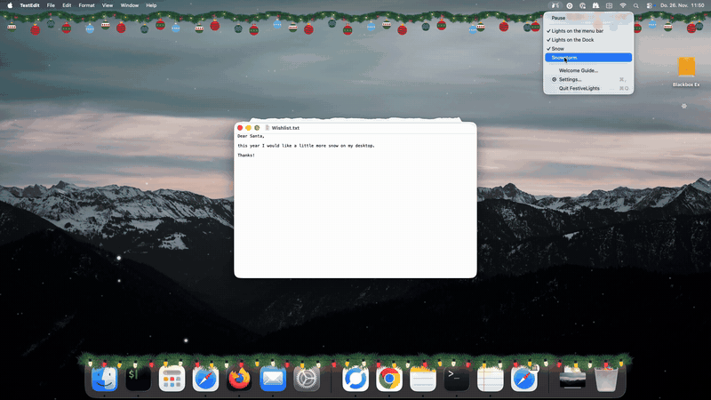

# FestiveLights

Christmas lights for your Mac: a garland under the menu bar, lights on the Dock, and snow that piles up on your windows. Free and open source.



**[Download for macOS 14 or later](https://github.com/krystofbe/festive-lights/releases/latest/download/FestiveLights.dmg)** · [Website](https://www.blackbox.ms/festive/) · [30 second video](https://youtube.com/shorts/xGinuTRNNHA) · Mac App Store: coming soon



| Fir, colorful | Fir, warm gold | Classic |
|---|---|---|
|  |  |  |

## What it does

- Hangs a pine garland (two variants) or a classic string of lights under the menu bar and on the Dock. Patterns, speed, size and sag are adjustable.
- The bulbs slide aside when your pointer comes near, so the menu bar stays usable. Clicks always go through lights and snow.
- Snow falls across the screen and settles on top of your windows. Shake a window to clear it, or start a snowstorm with one click.
- Works on several displays and follows the Dock when it moves. A full-screen app hides the lights only on its own display.
- Pause everything from the menu bar, for example during a presentation. In Low Power Mode it gets calmer on its own.
- English and German.



## Privacy

No account, no analytics, no tracking. The app only reads where windows are and how big they are, never their titles or content.

- **App Store version:** sandboxed, no network access at all.
- **Direct download:** checks GitHub once a day for updates (via [Sparkle](https://sparkle-project.org); GitHub sees your IP address and the app version). You can turn this off in Settings. It can optionally use the Accessibility permission, which only makes Dock tracking more precise; everything works without it.

## Price

Free. No in-app purchases, no subscription, MIT licensed. If you like it, [send us a Christmas card](https://www.blackbox.ms/festive/).

## Deutsch

Weihnachtslichter für den Mac: eine Girlande unter der Menüleiste, Lichter am Dock und Schnee, der auf deinen Fenstern liegen bleibt. Kostenlos und Open Source (MIT), für macOS 14 oder neuer. [Download](https://github.com/krystofbe/festive-lights/releases/latest/download/FestiveLights.dmg) · [Website](https://www.blackbox.ms/festive/) · [Datenschutz](https://www.blackbox.ms/festive/datenschutz/)

## Building

```sh
cp Local.xcconfig.example Local.xcconfig   # set your team and signing (not committed)
xcodegen generate
xcodebuild -project FestiveLights.xcodeproj -scheme FestiveLights -configuration Release build
xcodebuild test -scheme FestiveLights -destination 'platform=macOS'
```

There are two variants from the same code:

- **App Store** (scheme `FestiveLights`): sandboxed, no Accessibility, no update code.
- **Direct** (target `FestiveLightsDirect`, scheme `FestiveLights-Direct`, compile flag `DIRECT`): not sandboxed, optional Accessibility permission for more precise Dock tracking, Developer ID signed and notarized, shipped as a DMG, updates via Sparkle (once a day, no system profile, can be turned off in Settings > General).

Development builds with debug triggers: configuration `Test`.

### Releasing the direct download

1. Bump `MARKETING_VERSION` and `CURRENT_PROJECT_VERSION` in `project.yml`.
2. Write `ReleaseNotes/<version>.html` (HTML fragment, English first, then German).
3. Run `SPARKLE_BIN=/path/to/sparkle/bin scripts/release-direct.sh <version>`. It archives, exports with Developer ID, notarizes, builds the DMG and the appcast, and keeps the history from the previous release. It needs a signed-in Xcode account (or `NOTARY_PROFILE` for `notarytool`, see the top of the script) and your team ID in `Local.xcconfig`.
4. Upload `FestiveLights-<version>.dmg`, `FestiveLights.dmg` and `appcast.xml` as a GitHub release tagged with the version and mark it as latest.

The private key for the update signature lives only in the keychain of the release machine.

## License

MIT, see [LICENSE](LICENSE). A project by [Blackbox Innovation](https://www.blackbox.ms).
